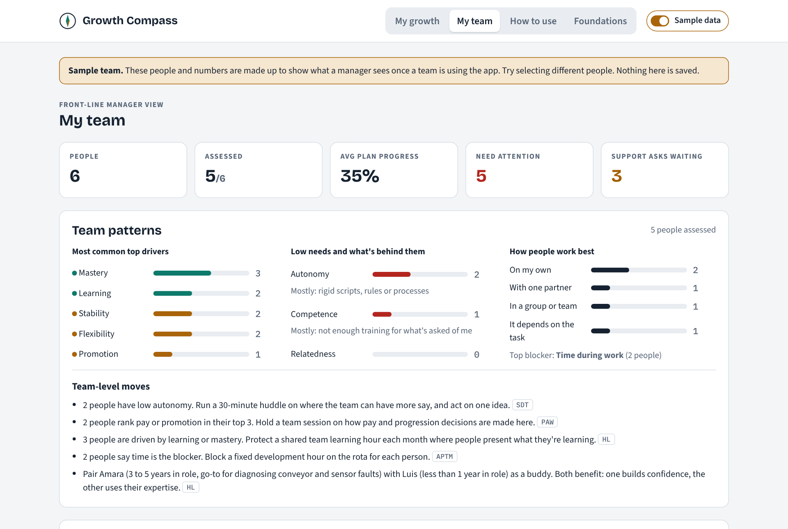
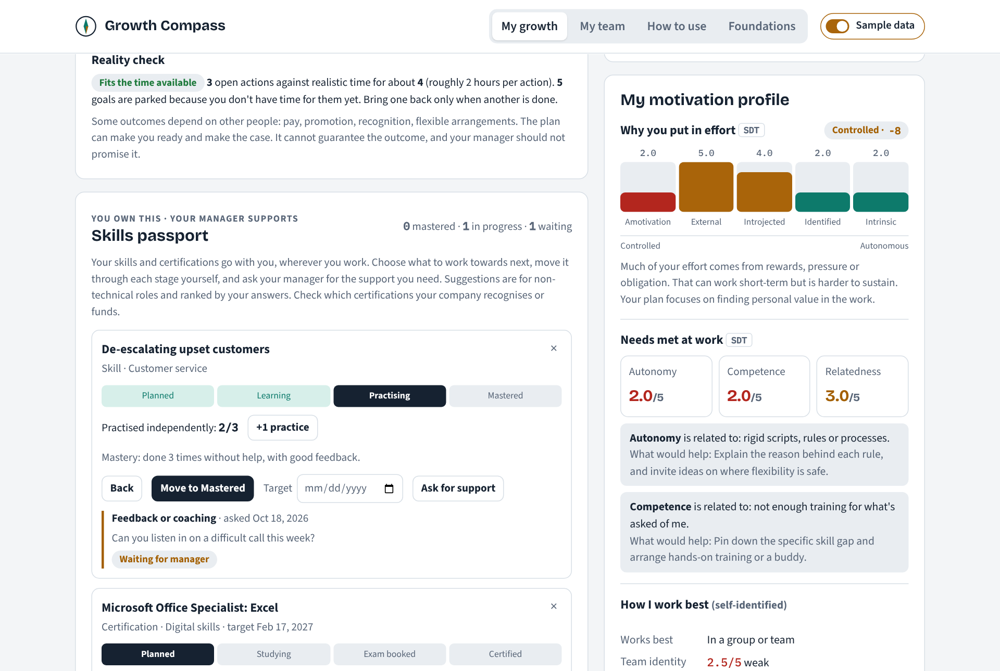
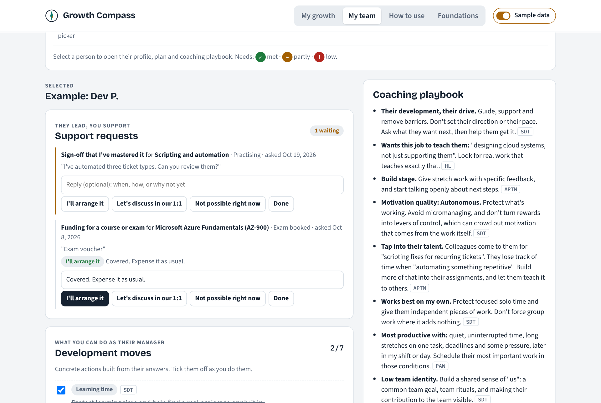
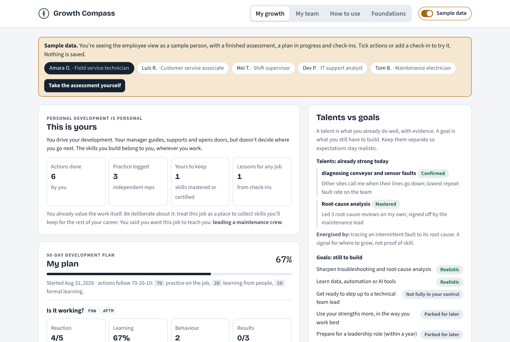
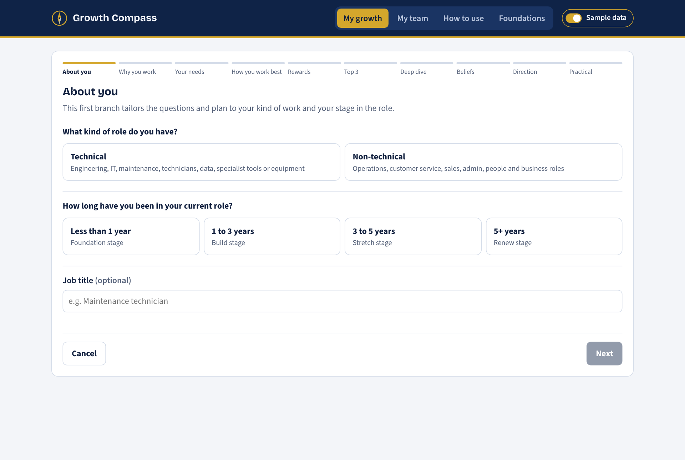
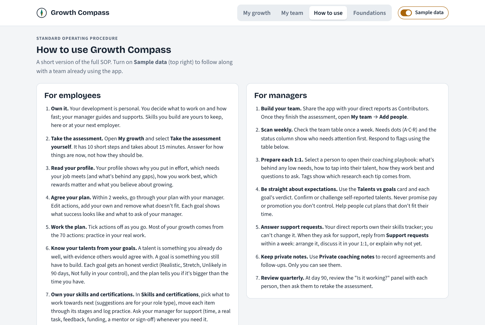
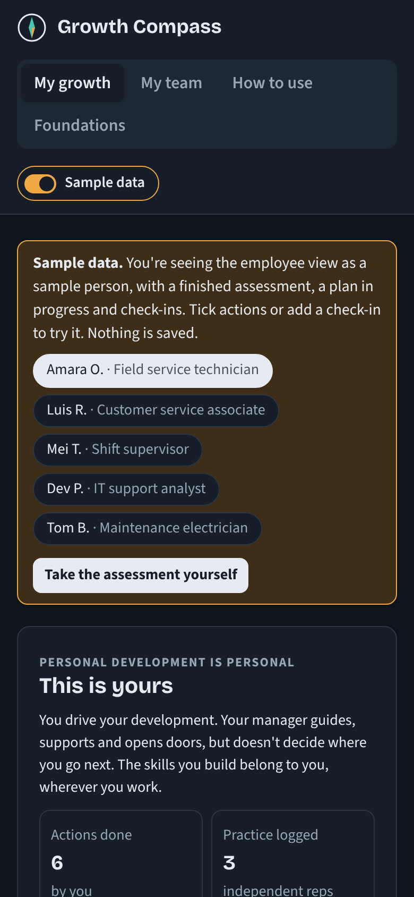

# Growth Compass

**A research-grounded personal development app for front-line managers and their teams.**

Growth Compass helps employees understand what really motivates them, and turns that into a realistic 90-day development plan that they own. Front-line managers act as a **supporting layer**, not a director: they see team patterns, answer support requests, and get a coaching playbook for each direct report.

## Principle: personal development is personal

- **The employee drives.** They choose what to develop, how fast, and how much of their own time to invest. The manager guides, supports and removes barriers, but doesn't set their direction.
- **Skills are portable.** What someone masters goes with them, whether their next step is in this company or another one. The app treats both as normal career moves.
- **A job is also a place to learn.** Every employee names what they want their job to teach them, besides pay, and logs lessons they could use in any job.
- **Motivation shapes the message.** Someone driven mainly by pay is shown that skills are what raise pay over time, here or elsewhere. Someone driven by the work itself is encouraged to collect skills deliberately.

> **Live demo:** open `index.html` in any browser, or visit the GitHub Pages site once it's enabled (see [Publishing](#publishing-on-github-pages)). The demo opens with **sample data** switched on: a made-up team of six people with finished assessments, plans, check-ins and support requests. Use **Sample data** in the top right to switch it off and take the assessment yourself.



---

## The problem

Front-line managers are often too busy to coach development, and generic development plans don't reflect what each person actually wants. Two people with the same job can be driven by completely different things: one wants mastery and autonomy, the other a predictable schedule and a clear path to a pay rise. A plan that ignores that gets ignored.

## What it does

### For employees: "My growth"

- **A branching assessment (10 steps, about 15 minutes).** It branches on **technical vs non-technical** roles and **years in the current role**, then covers:
  - *Why you work*: the self-determination motivation continuum, from external pressure to real enjoyment of the work.
  - *Your needs*: autonomy, competence and relatedness. When a need is low, the person names **what it's related to** (for example micromanagement, not enough training, or working apart from the team), so it can be fixed at the source.
  - *How you work best*, self-identified: alone, with a partner or in a group; team identity; productive conditions; peak time; and talents **with evidence**.
  - *Rewards*: 5 intrinsic and 5 extrinsic, a top 3, and a role-specific deep-dive question for each.
  - *Beliefs*: mindset, achievement-goal focus, confidence to learn, whether effort leads to results and results to rewards, and fairness.
  - *Career direction and practical constraints*: direction (including **a career that can go anywhere**, here or at another company), what they want this job to teach them, blockers, work time available, and optional own time.
- **A 90-day plan sized to the time available.** Goals have a *Success looks like* measure, and actions follow 70-20-10: practice on the job, learning from people, formal learning. Goals that don't fit the available time are **parked**, not hidden.
- **An honest reality check.** Every goal gets a verdict: *Realistic*, *Stretch*, *Unlikely in 90 days*, *Not fully in your control* or *Parked*. Pay, promotion, recognition and flexibility are clearly marked as depending on other people.
- **Talents vs goals.** A talent is something you already do well, with evidence. A goal is something you still have to build. Talents without evidence are labelled *self-reported*.
- **"This is yours."** An ownership card shows what the person has invested (actions done, practice logged, skills kept, lessons for any job), with a message tailored to their motivation.
- **Own-time investment (optional).** People choose how much personal time they'll invest, and the plan is sized to work time plus that.
- **A skills passport the employee owns.** Suggestions are tailored to technical or non-technical roles and ranked by the person's answers: CompTIA, AWS and Azure fundamentals, CMRT, PLC programming, NFPA 70E, Lean Six Sigma, supervisor certificates, CAPM, Excel, forklift, Mental Health First Aid and more, plus practical skills. Skills move Planned → Learning → Practising → **Mastered** (three independent practices). Certifications move Planned → Studying → Exam booked → **Certified**. Both need evidence. A **"Copy my passport"** button exports mastered skills, certifications and evidence as plain text for a CV or profile.
- **Support requests.** The employee asks their manager for exactly what they need: time, a real task to practise on, feedback, funding, a mentor, or sign-off.
- **Monthly check-ins.** Energy, productivity, wins, a lesson they could use in any job, where they applied something new, what made the difference (with a nudge toward controllable causes) and what they need.



### For managers: "My team"

- **A team overview.** Role type, time in role, motivation quality, needs (A·C·R), how each person works best, top drivers, plan progress, skills, last check-in and a status flag: *Disengagement risk*, *Retention risk*, *Fairness concern*, *Plan stalled*, *Support ask waiting* and more.
- **Team patterns.** The most common drivers, which needs are low and what's behind them, how people prefer to work, top blockers, and **team-level moves** such as a buddy pairing suggested from tenure and talent.
- **For each direct report:**
  - *Support requests*, answered with **I'll arrange it**, **Let's discuss in our 1:1**, **Not possible right now** or **Done**.
  - *Development moves*: a checklist of concrete actions built from their answers.
  - *A coaching playbook* with root-cause fixes, how to tap into their talent, how to set up their work, and honest guidance on what not to promise. Each tip is tagged with its research source.
  - *Private coaching notes*, visible only to the manager.



### How to use and Foundations

- **How to use**: an in-app summary of the [SOP](SOP.md), including how to respond to each status flag.
- **Foundations**: which research framework drives each part of the app.

## Research foundations

The assessment logic, plan generation and coaching guidance draw on the frameworks in:

| Tag | Work | What it contributes |
|---|---|---|
| `SDT` | Ryan & Deci, *Self-Determination Theory* | Motivation continuum, basic psychological needs, controlling vs informational rewards, autonomy-supportive management |
| `HCM` | Elliot, Dweck & Yeager (Eds.), *Handbook of Competence and Motivation* (2nd ed.) | Competence motivation, achievement goals (approach/avoidance), growth vs fixed mindset |
| `HL` | Ormrod, *Human Learning* (8th ed.) | Self-efficacy and modelling, self-regulated learning, attributions, practice and transfer |
| `PAW` | Howes & Muchinsky, *Psychology Applied to Work* (13th ed.) | Goal setting, expectancy theory, equity and justice, job characteristics, teams, training evaluation |
| `APTM` | Cascio & Aguinis, *Applied Psychology in Talent Management* (9th ed.) | Development needs assessment, performance management as ongoing coaching, career stages, fair use of assessments |

**Important:** the questions were written for this app, following the structure of these frameworks. They are **not** reproductions of published scales and have **not** been psychometrically validated. Growth Compass is a development tool. It must not be used for hiring, pay, ratings, promotion or discipline decisions. See [SOP section 7](SOP.md#7-privacy-and-appropriate-use).

## Screenshots

| | |
|---|---|
|  |  |
| Employee view with sample data | Branching assessment |
|  |  |
| In-app SOP summary | Phone, dark mode |

## Technical notes

- **One self-contained file** (`index.html`): vanilla JavaScript and CSS. No build step and no dependencies apart from Google Fonts.
- **Storage:**
  - *Standalone or GitHub Pages:* your own answers are saved in your browser (`localStorage`). Sample data is generated in memory and never saved.
  - *Claude Artifact version:* the same app runs as a shared Claude artifact. Each person's profile and plan is stored under their own record, and managers' notes are private to them.
- **Responsive** down to phone width, with **light and dark themes**, keyboard focus states and reduced-motion support.

## Publishing on GitHub Pages

1. Push this repository to GitHub.
2. Go to **Settings → Pages**, set **Source** to *Deploy from a branch*, pick `main` and `/ (root)`, and save.
3. After a minute the demo is live at `https://<your-username>.github.io/<repo-name>/`. Add that link to the top of this README and to your portfolio.

## Repository contents

```
index.html             The app (open it directly or serve with GitHub Pages)
SOP.md                 Standard operating procedure for employees, managers and programme owners
docs/screenshots/      Images used in this README
```
